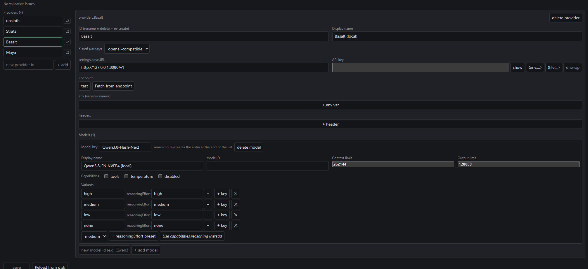

# opencode-config-gui

A local web app for editing [OpenCode](https://opencode.ai) config files
(`opencode.json`, `opencode.jsonc`, and the global config). It opens in your
browser, shows every OpenCode config it can find, and lets you edit them
without hand-juggling JSON — while keeping your API keys in your own files,
where they already live.



## Why

Editing provider configs by hand is error-prone: comments and formatting get
flattened by careless tools, the v1 → v2 config migration is fiddly, and it is
hard to tell whether a provider's `baseURL` actually works until opencode
fails in a session. This tool:

- **Keeps your file yours.** It edits JSONC *in place*: comments, key
  order and formatting survive round-trips (only the lines you touch change).
- **Validates before saving**, against the official OpenCode config schema,
  and refuses writes that would introduce *new* errors into an otherwise
  valid file.
- **Backs up every save** next to your config and writes atomically, so a
  crash mid-save cannot leave a half-written config.
- **Migrates v1 → v2 configs** with a full diff review before anything is
  written.
- **Probes OpenAI-compatible endpoints** (`{baseURL}/models`) so you can see
  which models a provider really serves, and whether the key works, before
  trusting the entry.

Bring your own config; this tool keeps your keys in your file. It never
copies your keys anywhere else, never logs them, and never sends them
anywhere except the provider endpoint you explicitly ask it to probe.

## Quick start

```
npx opencode-config-gui
```

That starts a server bound to `127.0.0.1` on a free port and opens your
browser. Pick a config file (it discovers the global one plus any project
ones under the current folder), edit, save.

Flags:

| Flag | Meaning |
| --- | --- |
| `--port <n>` | Port to bind on 127.0.0.1 (default: 0 = any free port) |
| `--folder <path>` | Project folder to seed config discovery (default: cwd) |
| `--static <dir>` | Built UI assets dir (default: `<package>/dist/ui` when it exists) |
| `--no-open` | Do not launch a browser |
| `--help` | Usage |

Requires Node.js 20 or newer at runtime.

### Running straight from a clone

Prefer not to go through `npx`? Clone the repo and use the launcher for
your platform — both install dependencies and build on first run, then
start the server. Any arguments pass through to the CLI:

```
.\launch.bat --folder .\my-project     # Windows
./launch.sh --folder ~/my-project      # Linux / macOS
npm start -- --folder ./my-project     # any platform (needs a build first)
```

## What you can do

- **Providers** — structured editor with presets for the common npm packages
  (`openai-compatible`, `openai`, `anthropic`, `google`, `google-vertex`)
  plus the local-runtime trio (**ollama**, **lmstudio**, **vllm**), which
  need no package and no hosted key. API keys are stored the way OpenCode
  expects: a literal in your file, or a `{env:NAME}` / `{file:PATH}`
  reference if you prefer to keep the secret out of the file itself.
- **Models & variants** — per-model options, limit placeholders and variant
  lists, spelled correctly for your document's shape.
- **MCP servers** — local and remote MCP entries, env blocks and enabled flags.
- **Raw JSON tab** — edit the file as text when you need full control;
  validation problems are reported against the same schema.
- **Endpoint probe** — check `baseURL` (+ key) against `/models`; get
  ok / auth-failed / unreachable / not-compatible plus the model list,
  without leaving the page.
- **v1 → v2 upgrade** — a preview dialog shows a unified diff of exactly what
  would change (providers map, `npm`→`package`, `options`→`settings`,
  variants, …). Nothing is written until you approve, and the write goes
  through the same backup/validate/atomic pipeline as a normal save.
- **Schema validation** — an honest provenance badge: live schema fetched
  from opencode.ai, cached on disk, falling back to the copy vendored in the
  package (so it also works offline).

## Security posture

- The server binds `127.0.0.1` only — never a public interface.
- Every request — the `/api/*` routes and the built UI it serves alike —
  must carry a local `Host` (and a matching `Origin` when present); foreign
  hosts and cross-site origins get a hard 403, which is what blocks
  DNS-rebinding and drive-by requests. Static assets answer GET/HEAD only.
  No CORS headers, ever.
- No analytics, no telemetry, no update pings. The only outbound requests
  are the ones you trigger: the schema refresh from opencode.ai and endpoint
  probes you press.
- API keys are read from your config only to fill the probe request you
  started; they are never written into logs, responses or error strings.
- Reads are restricted to config files the discovery rules can actually find;
  arbitrary paths over the API are refused.

## Contributing

Requirements: Node.js **>= 22.12** (the test runner, vitest 5, needs it —
the *shipped* code only needs Node 20, and CI smokes that separately) and npm.

```
npm ci
npm run typecheck
npm test
npm run build        # tsc -> vite (UI) -> scripts/postbuild.mjs
npm run smoke        # boots dist/cli.js, checks /api/state + UI + Host guard
node dist/cli.js --no-open           # run against this repo's folder
```

Dev loop: `npm run dev:server` (API on port 8710, watching `dist/`) plus
`npm run dev:ui` (Vite dev server proxying `/api` to 8710).

Layout: `src/core` (JSONC editing, discovery, schema validation, migration,
probe — pure TypeScript), `src/server` (node:http glue, 127.0.0.1-only),
`src/ui` (React + Vite), `test/` (vitest). `scripts/postbuild.mjs` copies the
vendored schema into `dist/` and ensures `dist/cli.js` keeps its shebang and
exec bit.

### Releasing

`npm publish` runs `prepublishOnly` (typecheck, tests, build). Tagging `v*`
triggers the GitHub release workflow: it compiles single-file binaries with
Bun for windows/linux/darwin × x64/arm64 and attaches them to the release —
each archive ships the binary plus its `dist/` data folder (vendored schema
and built UI) next to it.

## About this code

This codebase was written almost entirely by AI coding agents, directed and
reviewed by a human who mostly just said "That looks good, do it." Expect it to work —
134 tests and several review passes say so — but extend it at your own risk,
and keep the same sense of humor in the pull requests.

## License

Released under the [MIT License](LICENSE) - do whatever you want with it,
just keep the copyright line. Your configs and your API keys were never
part of the deal anyway; they stay in your files.
